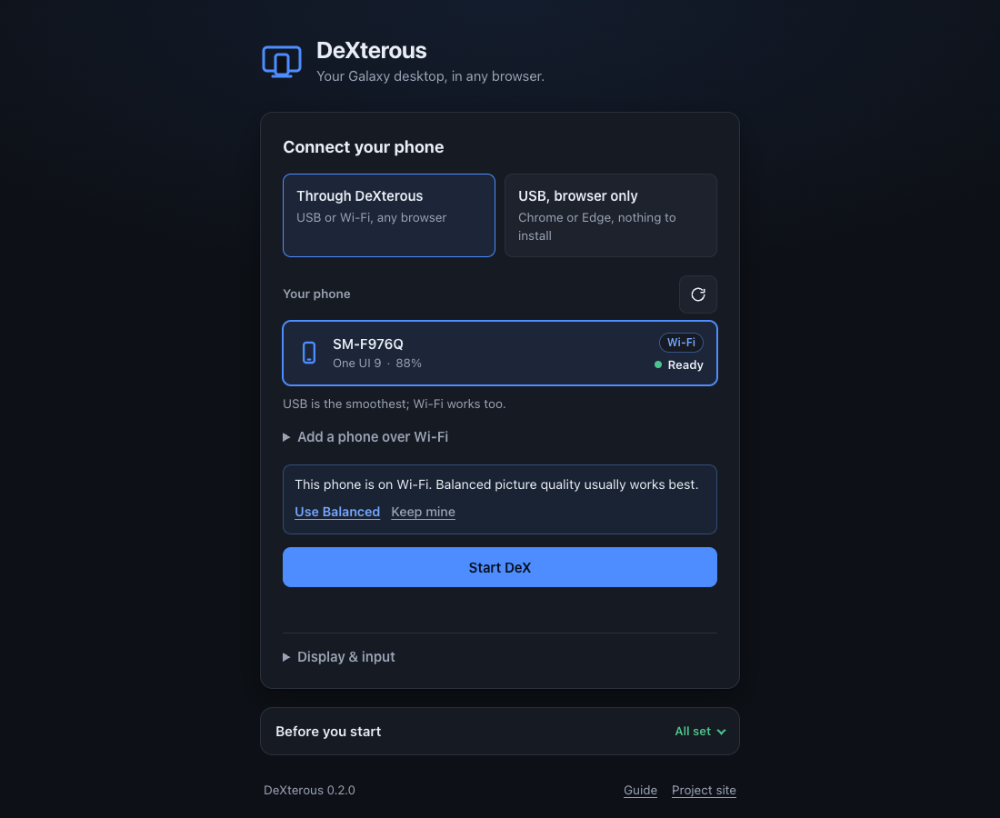

# DeXterous

**Your Galaxy desktop, in any browser.**

DeXterous runs Samsung DeX from your Galaxy phone or tablet in a browser tab: on a Mac, a Windows PC, a Linux box or even an iPad. Samsung discontinued its DeX apps for Windows and Mac; DeXterous brings DeX back to your computer without them. It doesn't mirror your phone screen. It gives the phone a second, *virtual* monitor sized to your browser window, and DeX runs on it. You get a real desktop with resizable windows, a taskbar, right-click menus, your keyboard and the phone's audio, and the phone stays usable at the same time. No root, and no app to install on the phone.

> DeXterous is an independent project. It is not affiliated with or endorsed by Samsung. "Samsung", "Galaxy" and "DeX" are trademarks of Samsung Electronics.



New here? The [user guide](docs/GUIDE.md) walks through everything step by step. The project site is at [subsneaker.github.io/DeXterous](https://subsneaker.github.io/DeXterous/).

## Highlights

- **A real desktop, not a mirror.** DeX runs on its own virtual display that follows the size of your browser window. Your phone keeps working as a phone.
- **Any modern browser.** It's built on standard web APIs (WebCodecs, WebSockets), so Chrome, Edge, Safari and Firefox on macOS, Windows and Linux, or another device on your network such as an iPad, should all work. So far it has been tested in Chrome on macOS.
- **Smooth video.** Hardware decoding with WebCodecs (H.264, H.265 or AV1) at up to 120 fps.
- **Sound.** Phone audio plays in the browser, with a mute button.
- **Mouse, keyboard and touch.** Hover, right-click menus, scrolling, multi-touch, IME and non-English text, and Mac-style ⌘ shortcuts.
- **Shared clipboard.** Copy on one side, paste on the other, or keep the two clipboards separate.
- **Lock-aware.** When the phone locks, DeXterous covers DeX, blocks input and mutes audio until you unlock it.
- **Guided setup.** The connect screen lists your phones with their One UI version and battery, checks your setup step by step, and can add a phone over Wi‑Fi.
- **Local by default.** It only listens on `localhost`. Access from other devices needs HTTPS and an access token. No telemetry: the only thing DeXterous asks the internet is npm's registry, about once a day, for the latest version number. You can [turn that off](#updating).

## Requirements

- **A Galaxy phone or tablet on One UI 8 or newer.** Since One UI 8, DeX can run on a virtual display. Older versions only show a plain launcher. Tested on a Galaxy Z Fold8 (One UI 9, Android 17).
- **USB debugging** turned on. See [Quick start](#quick-start).
- **Node.js 22.18 or newer** on the computer the phone connects to.
- **Android platform-tools** (`adb`) for the default relay mode:

  | OS | Install adb with |
  |---|---|
  | macOS | `brew install --cask android-platform-tools` |
  | Windows | `winget install Google.PlatformTools` |
  | Linux | Your distro's package (`android-tools-adb` or `android-tools`), or Google's [platform-tools zip](https://developer.android.com/tools/releases/platform-tools) |

- **A browser with WebCodecs:** Chrome, Edge, Opera, Safari 17+ or Firefox 130+.

## Install

Once you have Node.js and adb (see [Requirements](#requirements)), install the `dexterous` command from npm:

```bash
npm install -g @subsneaker/dexterous
dexterous
```

**Run it without installing:**

```bash
npx @subsneaker/dexterous@latest
```

**From source:**

```bash
git clone https://github.com/SubSneaker/DeXterous.git
cd DeXterous
npm install
npm start
```

`npm install` builds everything. The first build downloads the scrcpy server (v5.0.1) from GitHub and checks its SHA-256. To also get the `dexterous` command, run `npm install -g .` in that folder. It links the command to the clone, so keep the folder.

On Linux, if `npm install -g` fails with `EACCES`, see [the guide](docs/GUIDE.md#linux).

To uninstall: `npm uninstall -g @subsneaker/dexterous`. The [guide](docs/GUIDE.md#updating-and-uninstalling) explains how to remove the rest.

## Updating

DeXterous looks for a new version about once a day: when it starts, if the last check is more than a day old, and again while it runs. When there is one, it prints a line in the terminal, and the DeXterous page shows a banner with a *What's new* link.

- **Installed with npm:** click *Update now* in the banner on the DeXterous page, or stop DeXterous and run `dexterous update`. The page can do it while DeX isn't running: DeXterous installs the update, restarts in the same terminal and reloads the page.
- **With npx:** `npx @subsneaker/dexterous@latest` always starts the newest version.
- **From source:** `git pull`, then `npm install`.

`dexterous update --check` only checks. If npm needs `sudo` on your computer, DeXterous can't update itself; run `sudo npm install -g @subsneaker/dexterous@latest` instead. What's new in each version is in the [changelog](CHANGELOG.md).

The check sends nothing about you or your phone: it asks npm's registry for the latest version number of `@subsneaker/dexterous`, and remembers the answer for a day. To turn it off, start DeXterous with `--no-update-check`, or set `DEXTEROUS_NO_UPDATE_CHECK=1`. It's also off when `$CI` is set and when DeXterous runs from a clone of the repository. See [SECURITY.md](SECURITY.md#update-checks-and-self-updates) for the details.

## Quick start

1. **Turn on USB debugging.** On the phone, open *Settings › About phone › Software information* and tap *Build number* 7 times. Then turn on *Settings › Developer options › USB debugging*.
2. **Run `dexterous`.** It starts a small local server (the relay) and opens **http://localhost:8686** in your browser. Keep the terminal open while you use DeX.
3. **Plug the phone in** with a USB cable and unlock it. When it asks *Allow USB debugging?*, tick *Always allow from this computer* (the phone's own wording) and tap *Allow*.
4. **Pick your phone** under *Your phone* and click **Start DeX**. The card shows the phone's name, One UI version and battery, and says *Ready* once the phone has allowed your computer. If something is missing, the *Before you start* list below says what to do next.
5. **Unlock the phone** if DeXterous says it's locked. DeX appears in the tab.
6. **Press Ctrl+Alt+/** (⌃⌥/ on a Mac) to see all shortcuts and commands. Press Ctrl+C in the terminal to stop DeXterous.

Prefer Wi‑Fi? Open *Add a phone over Wi‑Fi* on the connect screen and enter the address from the phone's *Wireless debugging* screen. See [Connect over Wi‑Fi](docs/GUIDE.md#connect-over-wi-fi).

## Using it

### Shortcuts

All DeXterous shortcuts are **Ctrl+Alt** plus a key (**⌃⌥** on a Mac). Every other key goes to DeX.

| Shortcut | Does |
|---|---|
| Ctrl+Alt+L | Lock the phone |
| Ctrl+Alt+W | Wake the phone's screen |
| Ctrl+Alt+P | Turn the phone's own screen off or on (DeX keeps running) |
| Ctrl+Alt+B / H / R | Back / Home / Recent apps |
| Ctrl+Alt+M | Mute or unmute phone audio |
| Ctrl+Alt+F | Full screen |
| Ctrl+Alt+S | Connection stats (resolution, fps, decoding, audio) |
| Ctrl+Alt+/ | Show or hide the shortcuts and commands panel |
| Ctrl+Alt+Q | Disconnect |
| Esc | Close the panel |

Holding a shortcut doesn't repeat it. Your computer may reserve some of these: Ctrl+Alt+L locks the screen on many Linux desktops, and ChromeOS uses Ctrl+Alt+/. Use the dock or the panel for those instead.

The panel also lists DeX's own shortcuts: ⊞+/ (all DeX shortcuts), ⊞+← / ⊞+→ (snap a window), ⊞+D (show the desktop), Alt+Tab (switch apps, in full screen), Alt+F4 (close the window) and paste.

### Mouse, keyboard and touch

- **Mouse:** a real mouse pointer. Hover, right-click context menus, drag windows by their title bars and resize them from the edges. The side buttons work as Back and Forward.
- **Keyboard:** typing goes straight to DeX. On a Mac, the left ⌘ acts as Ctrl (⌘C, ⌘V, ⌘A…) and the right ⌘ is DeX's ⊞ key (⊞+D, ⊞+arrows, ⊞+/). You can turn that off with *Use ⌘ as Ctrl*. Non-English text (Hebrew, accented letters, emoji) and IME input are pasted in through the phone's clipboard.
- **Touch screens:** multi-touch works. The ⌄ button in the top-right corner shows the dock; tap its keyboard button to bring up the on-screen keyboard.
- **Full screen** (Ctrl+Alt+F) in Chrome or Edge also captures Esc, ⌘/Windows and browser shortcuts, so they reach DeX. Hold Esc to leave full screen.
- **Resizing** the browser window resizes the DeX desktop to match.

### Controls dock

Move the mouse to the top edge of the window. The dock has Back, Home, Recent apps, show keyboard, mute, lock phone, full screen, the shortcuts panel (?) and disconnect. On a touch screen, tap the ⌄ handle in the top-right corner.

### Clipboard

With *Share the clipboard with this device* on (the default), there's one clipboard: anything you copy in DeX lands on the clipboard of the device you're using, and ⌘V / Ctrl+V pastes that device's clipboard into DeX. Turn it off to keep two separate clipboards; ⌘V / Ctrl+V then pastes the phone's own clipboard. You can switch it mid-session in the shortcuts panel.

### When the phone locks

By default, when the phone locks (side key, *Lock phone* or Ctrl+Alt+L), DeXterous covers the desktop, ignores input, mutes the phone's audio and holds back clipboard copies until you unlock the phone. While it can't tell whether the phone is locked, it shows *Checking your phone…* and stays covered.

To keep working without unlocking, turn on *Keep DeX usable while the phone is locked*. You can only switch it on while the phone is unlocked. This is a convenience, not a security boundary: anyone who can use your computer's adb can control the phone anyway, so lock your computer too.

### Staying awake and disconnecting

- While DeXterous is connected, it keeps the phone awake over USB and Wi‑Fi, so DeX doesn't doze off mid-use. The phone only locks when you lock it: with the side key, Ctrl+Alt+L or the dock's lock button.
- When you disconnect or close the tab, your open apps move back to the phone, like unplugging a DeX monitor. You can change this in *Display & input*.

## Settings

The *Display & input* section on the connect screen. Your browser remembers these. Most take effect the next time you click **Start DeX**; the clipboard, ⌘ and lock settings can also be changed mid-session in the shortcuts panel.

**Picture quality** sets sharpness, codec, bitrate and frame rate in one go:

| Preset | Sharpness | Codec | Bitrate | Frame rate |
|---|---|---|---|---|
| **Best (USB)**, the default | 2× | H.265 (H.264 if your browser can't decode H.265) | 24 Mbps | 60 fps |
| **Balanced (Wi‑Fi)** | 1.5× | H.264 | 8 Mbps | 60 fps |
| **Light** | 1× | H.264 | 4 Mbps | 30 fps |
| **Custom** | your choice | your choice | your choice | your choice |

If you pick a phone that's on Wi‑Fi while *Best* (or a custom mix above 8 Mbps) is selected, DeXterous suggests *Balanced*: click *Use Balanced* or *Keep mine*. Choosing *Custom*, or changing any of the four settings below, makes your own mix.

| Setting | What it does |
|---|---|
| Sharpness | Under *Custom*. Virtual display pixels per browser pixel: *Retina (2×)*, *Balanced (1.5×)* or *Fast (1×)*. 2× is crisp on HiDPI screens; 1× is lightest on the phone and the network. |
| Video codec | Under *Custom*. H.264 works everywhere. H.265 is sharper at the same bitrate in Chrome and Safari. AV1 needs a recent phone. Codecs your browser can't decode are greyed out. |
| Bitrate / Frame rate | Under *Custom*. 4, 8, 16 or 24 Mbps, and 30, 60 or 120 fps. Lower the bitrate for Wi‑Fi. |
| DeX text size | Scales DeX's UI by setting the virtual display's DPI. |
| Play phone audio here | Sends the phone's audio to the browser. The phone's speaker goes quiet unless *Keep audio on the phone too* is on (Android 13+). |
| Share the clipboard with this device | One clipboard for both (default), or two separate ones. |
| Use ⌘ as Ctrl | Mac only, on by default. Left ⌘ acts as Ctrl; right ⌘ stays DeX's ⊞ key. |
| Show the Android on-screen keyboard | Shows Android's keyboard on the DeX screen when a text field is focused. Off by default. |
| Move open apps to the phone on disconnect | On by default. When off, apps open on DeX are closed when you disconnect. |
| Keep DeX usable while the phone is locked | Off by default, so a locked phone also covers DeXterous. Can only be turned on while the phone is unlocked. |

## Connection modes

| Mode | How to start | Works in | Notes |
|---|---|---|---|
| **Through DeXterous** (default) | `dexterous` | Any modern browser on your computer | Uses the computer's adb server, so the phone can be on USB *or* Wi‑Fi adb. A desktop `scrcpy` can keep running alongside; turn its audio off (`scrcpy --no-audio`) or you'll hear everything twice. |
| **From other devices on your network** (iPad, laptop…) | `dexterous --lan` | Any modern browser on your LAN | Serves HTTPS with a self-signed certificate and requires an access token. Open the printed `https://<ip>:8686/#token=…` link and accept the certificate warning once. The computer's firewall must allow incoming connections; on a Mac, *Block all incoming connections* must be off. Safari and iPad may refuse the self-signed certificate for the live connection; if so, use `--cert`/`--key` with a certificate from mkcert or `tailscale cert`. |
| **USB, browser only** | Open the app, choose *USB, browser only* | Chrome, Edge (WebUSB) | The browser talks to the phone directly over USB, with no relay. The built `dist/` folder can be hosted on any HTTPS static host, even under a sub-path. The computer's own adb server must not be holding the phone: run `adb kill-server` first. |

Details for each mode are in the [guide](docs/GUIDE.md).

## Command line

```text
dexterous [options]
dexterous update [--check]  install the latest version (--check: only check)
npm start -- [options]      (from source)
```

| Option | Default | What it does |
|---|---|---|
| `-p, --port <n>` | `8686`, or `$PORT` | Port to listen on. |
| `--host <addr>` | `127.0.0.1` (`0.0.0.0` with `--lan`) | Address to bind. A non-loopback address implies `--lan`. |
| `--lan` | off | Let other devices on your network connect: binds all interfaces, serves HTTPS with a self-signed certificate and requires the access token. |
| `--https` | off | Serve HTTPS on localhost too. |
| `--cert <file>` `--key <file>` | | Use your own certificate and private key (PEM) instead of the self-signed one, e.g. from mkcert or `tailscale cert`. |
| `--adb <host:port>` | `127.0.0.1:5037`, or `$ADB_SERVER_SOCKET` / `$ANDROID_ADB_SERVER_PORT` | adb server to use. If nothing is listening on the default address, DeXterous starts one with `adb start-server`. |
| `--allow-origin <url>` | | Also accept pages from this origin, e.g. a reverse proxy. Repeatable. Implies `--require-token`. |
| `--require-token` | off (on with `--lan`) | Require the access token on localhost too. |
| `--dist <dir>` | the package's built app | Serve the web app from another directory. |
| `--no-open` | | Don't open the browser on start. It isn't opened anyway when `$CI` is set, when the output isn't a terminal, or on Linux without a graphical display. |
| `--no-update-check` | | Don't check npm's registry for new versions. See [Updating](#updating). |
| `-v, --verbose` | | Log every tunnel connection. |
| `-V, --version` | | Print the version. |
| `-h, --help` | | Show the help. |

| Environment variable | Meaning |
|---|---|
| `PORT` | Default for `--port`. |
| `ADB_SERVER_SOCKET` | adb server address in adb's format, e.g. `tcp:127.0.0.1:5037`. |
| `ANDROID_ADB_SERVER_PORT` | adb server port on 127.0.0.1. |
| `DEXTEROUS_TOKEN` | A fixed access token to use instead of the generated one (at least 16 random characters). |
| `DEXTEROUS_HOME` | Directory for DeXterous's state files, instead of the default below. |
| `DEXTEROUS_NO_UPDATE_CHECK` | Set to `1` to turn off update checks, like `--no-update-check`. |
| `DEXTEROUS_UPDATE_REGISTRY` | The npm registry to check for updates, if you use a mirror. Default: `https://registry.npmjs.org`. |

DeXterous keeps its state in a per-user directory: `token` (the access token), `cert.pem` and `key.pem` (the self-signed certificate and its private key). Keep them private. Delete `token` to rotate the token. `update-check.json` remembers the last update check, and `update.log` holds npm's output from the last update installed from the page.

| OS | State directory |
|---|---|
| macOS | `~/Library/Application Support/DeXterous` |
| Windows | `%APPDATA%\DeXterous` |
| Linux | `~/.config/dexterous` (or `$XDG_CONFIG_HOME/dexterous`) |

## Troubleshooting

- **`dexterous: command not found`:** npm's global folder isn't on your `PATH`. `npm prefix -g` shows where it is (the command lives in its `bin` folder on macOS and Linux). Or run it with `npx @subsneaker/dexterous@latest`.
- **No phone in the list:** the *Before you start* list on the connect screen shows which step is missing. Unlock the phone, check that USB debugging is on, and run `adb devices`. Tap *Allow* on the phone if it asks.
- **A phone card says *Tap Allow on your phone*:** unlock it and tap *Allow* on the *Allow USB debugging?* prompt.
- **A phone card says *needs One UI 8+* or *not a Galaxy*:** DeX in a browser needs a Galaxy on One UI 8 or newer. Update the phone in *Settings › Software update*.
- **"DeXterous can talk to adb" isn't ticked, or "The relay couldn't talk to adb":** install Android platform-tools (see [Requirements](#requirements)), then restart `dexterous`.
- **"Port 8686 is already in use":** another DeXterous is probably running. Stop it, or pick another port with `--port`.
- **"Your phone is locked" / "Your phone is asleep" / "Checking your phone…":** unlock the phone (*Wake phone screen* turns its screen on first). To skip this in future, turn on *Keep DeX usable while the phone is locked* while the phone is unlocked.
- **Frozen desktop with that setting on:** some phones still pause DeX when their screen goes fully off. Press Ctrl+Alt+W to wake the phone.
- **Video codec greyed out:** this browser can't decode it. H.264 works everywhere.
- **"The phone refused to create a virtual display":** the phone is on One UI 7 or older.
- **WebUSB says the device is busy:** another adb program is holding the phone. Run `adb kill-server`, or use relay mode.
- **Choppy over Wi‑Fi:** pick *Balanced (Wi‑Fi)* or *Light* under *Picture quality*. USB is always smoothest.
- **Text is too big or too small:** change *DeX text size*, then start again.
- **Audio plays twice, slightly out of sync:** a desktop `scrcpy` is also forwarding audio. Run it with `--no-audio`.
- **Other devices can't connect in `--lan` mode:** check the computer's firewall (see [Connection modes](#connection-modes)).

More answers are in the guide's [troubleshooting and FAQ](docs/GUIDE.md#troubleshooting).

## What's been tested

Tested on a Galaxy Z Fold8 (One UI 9, Android 17) with Chrome on macOS:

- **Tested:** connecting through the relay over USB and Wi‑Fi, DeX on the virtual display, hardware video decoding, resizing the window, audio arriving in the browser, disconnecting and reconnecting, phone-side cleanup, lock and sleep detection, and the access-token checks.
- **Not yet verified on a device:** what typing, clicks, touch and clipboard actually do inside DeX (the phone was locked during testing), browser-only USB mode, LAN mode from another device (including an iPad), Safari and Firefox, and the npm install on Windows and Linux. CI builds DeXterous, installs the npm package and smoke-tests it on macOS, Windows and Linux.

## Known limitations

These come from how scrcpy injects input.

- **The left mouse button acts like a finger.** Hover, right-click and middle-click are real mouse events, but scrcpy sends left clicks and drags as touches. Dragging across text in some apps scrolls instead of selecting. Double-click or long-press to select instead.
- **Shift+click and Ctrl+click** arrive without the modifier.
- **Typing non-English characters** goes through the phone's clipboard, so it replaces whatever you had copied on the phone.
- **Browser-reserved shortcuts** (⌘W, ⌘T, ⌘Q, Alt+Tab) stay with the browser unless you're in full screen in Chrome or Edge.

## How it works

```text
 Galaxy phone (One UI 8+)            Your computer                  Browser tab
┌──────────────────────────┐        ┌───────────────────┐        ┌────────────────────────────┐
│ DeX on a virtual display │ USB or │ adb server        │   WS   │ Tango: ADB + scrcpy client │
│ scrcpy server (no root)  │◀──────▶│ DeXterous relay   │◀──────▶│ WebCodecs video, audio     │
│                          │ Wi-Fi  │ (a byte tunnel)   │        │ mouse, touch, keyboard     │
└──────────────────────────┘        └───────────────────┘        └────────────────────────────┘
```

- **On the phone**, DeXterous uses the stock [scrcpy](https://github.com/Genymobile/scrcpy) server (v5.0.1, Apache-2.0). It's pushed to `/data/local/tmp/dexterous-server.jar` each time you connect and started over adb. It creates a virtual display (`new_display`) that the browser can resize (`flex_display`), and `vd_destroy_content` decides whether apps move back to the phone when it closes. Samsung's DeX starts on that display automatically.
- **In the browser**, [Tango](https://github.com/yume-chan/ya-webadb) (MIT), an ADB and scrcpy client written in TypeScript, runs the whole session. Video is decoded with WebCodecs and drawn with WebGL. Audio is raw PCM played through an AudioWorklet.
- **The relay** is a small byte tunnel. Each browser WebSocket becomes one TCP connection to the computer's adb server, so all ADB and scrcpy logic still runs in the browser. It also serves the web app. In browser-only USB mode there's no relay: the browser talks to the phone over WebUSB.
- **The phone's lock state** is read about once a second (`dumpsys power` / `dumpsys trust`) through a single long-lived adb shell.

## Development

```bash
npm install         # installs dependencies and builds everything
npm run relay       # terminal 1: the relay on :8686, from the TypeScript source
npm run dev         # terminal 2: Vite dev server with hot reload
```

| Script | What it does |
|---|---|
| `npm start` | Start DeXterous from the last build (same as `dexterous`). Options go after `--`. |
| `npm run start:lan` | Same, with `--lan`. |
| `npm run build` | Download the scrcpy server if it's missing (SHA-256 checked), type-check and build the web app into `dist/`, and compile the relay into `build/server/`. `npm install` runs it for you. |
| `npm run dev` | Vite dev server with hot reload. Proxies `/adb` and `/api` to a relay on port 8686, so run `npm run relay` alongside. |
| `npm run relay` | Run the relay from the TypeScript source, without opening a browser. |
| `npm run typecheck` | Type-check the web app and the relay. |

| Folder | Contents |
|---|---|
| `bin/` | The `dexterous` command, which starts the relay and restarts it after an update. |
| `server/` | The relay: HTTP(S) server, WebSocket-to-adb tunnel, access checks, certificates, update checks. |
| `src/` | The web app: UI controller, scrcpy session, input, transports, settings and styles. |
| `public/` | Static files copied into the build. The scrcpy server and its license are downloaded here at build time. |
| `docs/` | The user guide. |
| `scripts/` | Build helpers and the smoke test. |

CI runs on GitHub Actions (Linux with Node 22 and 24, macOS and Windows with Node 22): type-check, build, and smoke tests of the build and of the packed npm package. Pushing a version tag publishes the package to npm. [CONTRIBUTING.md](CONTRIBUTING.md) has the architecture map, the coding rules and the release steps.

## Security

The relay can run any adb command on your phone, so treat its address and token like a password. By default it only listens on `127.0.0.1` and rejects pages from other origins and DNS-rebinding attempts. `--lan` mode adds HTTPS and requires the access token. Installing an update from the page only works from the computer DeXterous runs on, never from another device. Never expose DeXterous to the internet. See [SECURITY.md](SECURITY.md) for the threat model and how to report a vulnerability.

## Contributing

Bug reports, ideas and pull requests are welcome. Please read [CONTRIBUTING.md](CONTRIBUTING.md) first, and use the issue templates.

## License

DeXterous is released under the [MIT License](LICENSE). © 2026 SubSneaker.

It ships the scrcpy server (Apache-2.0) and bundles Tango (MIT). See [THIRD_PARTY_NOTICES.md](THIRD_PARTY_NOTICES.md).

---

DeXterous is not affiliated with or endorsed by Samsung. "Samsung", "Galaxy" and "DeX" are trademarks of Samsung Electronics.
